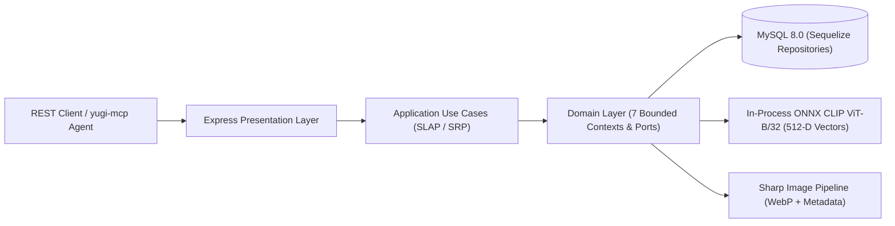

# 🃏 Yu-Gi-Oh! GX Tag Force — Hexagonal DDD Backend & Multimodal CLIP Search (`yugioh-ts-ddd`)

[](https://github.com/marcgaya98/yugioh-ts-ddd/actions/workflows/ci.yml)
[](./docker-compose.yml)
[](./tsconfig.json)
[](#3-system-architecture)
[](./src/infrastructure/ai)
[](./tests)
[](https://opensource.org/licenses/MIT)

> **Elevator Pitch:** Enterprise-grade TypeScript backend engineered with **Domain-Driven Design (DDD)** and **Hexagonal Architecture** that unifies relational Yu-Gi-Oh! GX Tag Force game mechanics (catalog, pack exclusivity, banlists, character decks) with **in-process ONNX CLIP (`512-dim`) multimodal vector search** for sub-15ms text-to-image and image-to-image card discovery.

### 🌐 Ecosystem Repositories

| Repository | Role | Stack |
|---|---|---|
| **[`yugioh-ts-ddd`](https://github.com/marcgaya98/yugioh-ts-ddd)** *(this repo)* | Core DDD REST API & Multimodal CLIP (`512-D`) Vector Search Engine | TypeScript, Express 5, Sequelize, MySQL 8, ONNX CLIP |
| **[`yugi-mcp`](https://github.com/marcgaya98/yugi-mcp)** | Model Context Protocol (MCP) Server exposing 22 tools to LLM Agents | TypeScript, MCP SDK (`stdio`), Zod |
| **[`card-analysis`](https://github.com/marcgaya98/card-analysis)** | Multi-Label Deep Learning Card Mechanics Classifier (`11 genres`) | Python 3.11, PyTorch, RoBERTa, FastAPI |

---

## 1. Live Demo



---

## 2. System Architecture



### Bounded Contexts (`src/domain/`)

| Bounded Context | Core Responsibilities & Pure Domain Services |
|---|---|
| **`catalog`** | Rich `Card` aggregate root, `Genre`, `CardSearchCriteria`, multi-attribute/type/ATK/DEF filtering |
| **`obtention`** | `ObtentionMethodResolver` & `ExclusiveCardCalculator` across Booster Packs, Characters, Card Converter, Tutorial, Sandwich, and Initial Deck |
| **`ai-search`** | `VisualSimilarityCalculator` (L2-normalized `512-dim` cosine similarity), `VISUAL_CONCEPTS`, and `CardEmbeddingRepository` (`clip_embedding`) |
| **`limit-list`** | Historical Banlist rules (`Forbidden`, `Limited`, `Semi-Limited`) and `LimitListSummary` statistics |
| **`duelist`** | Duel Academy characters, partner progression, and tournament deck recipes |
| **`game-stats`** | Victory bonuses, duel rankings, titles, and icon taxonomy |
| **`media`** | `ImageStoragePort` and `CardImageMetadataPort` for local card artwork resolution |

---

## 3. Technical Decisions & Trade-offs (ADRs)

### ADR-01: In-Process ONNX CLIP (`512-D`) vs. External Vector Databases or Color Heuristics
- **Context:** Users and AI agents need to search cards by visual artwork (*"warrior with sword and armor"*, *"fiery dragon"*) and find visually similar cards without manual tagging.
- **Decision:** Standardized the entire visual search pipeline on **`clip_embedding`** (`Xenova/clip-vit-base-patch32`, `512-dim` L2-normalized vectors) executed in-process via ONNX Runtime and persisted in MySQL JSON, removing legacy `21-dim` color/composition heuristics.
- **Trade-off:** For a bounded domain catalog (`2,540` cards), in-memory/in-process cosine similarity scans all `2,449` embedded cards in **`< 12 ms`** with **zero network hops** and **zero operational overhead** compared to hosting a separate Milvus/Pinecone/Qdrant cluster. If the catalog scaled beyond `500,000` vectors, an ANN index (`HNSW` via `pgvector` or Qdrant) would replace the linear scan behind `CardEmbeddingRepository` without touching the Domain or Application layers.

### ADR-02: Hexagonal DDD & Constructor Dependency Injection vs. Anemic CRUD MVC
- **Context:** Card obtention exclusivity rules (determining whether a card can *only* be obtained via the Card Converter or a single character partnership) previously leaked into 300-line Express controllers coupled to Sequelize models.
- **Decision:** Extracted pure domain services (`ExclusiveCardCalculator`, `ObtentionMethodResolver`, `VisualSimilarityCalculator`) and inverted all infrastructure dependencies via TypeScript interfaces (`CardRepository`, `PackRepository`, `CardEmbeddingRepository`) wired in a single composition root (`DIContainer`).
- **Trade-off:** Slightly higher initial file count, traded for **100% unit-testable domain logic without a database** and strict adherence to SRP, OCP, and DIP.

---

## 4. Single-Command Quickstart

Spin up the complete stack (API + MySQL 8.0 with healthchecks) in a single command:

```bash
docker compose up --build
```

### Verify the Running Service

```bash
# 1. Health Check
curl http://localhost:3001/health

# 2. Natural Language Visual Search (CLIP 512-D Text-to-Image)
curl -X POST "http://localhost:3001/api/semantic-search" \
  -H "Content-Type: application/json" \
  -d '{"query": "warrior with sword and armor", "limit": 5}'

# 3. Card Obtention & Exclusivity Analysis
curl "http://localhost:3001/api/obtentions/card/18"
```

- **Interactive Visual Search Lab UI**: `http://localhost:3001/visual-search.html`
- **REST API Base URL**: `http://localhost:3001/api`

---

## 5. Local Development & Testing

```bash
# Install dependencies
npm install

# Compile TypeScript (strict mode)
npm run build

# Run full automated test suite (57 unit & integration tests)
npm test
```

## License

Released under the [MIT License](https://opensource.org/licenses/MIT).
